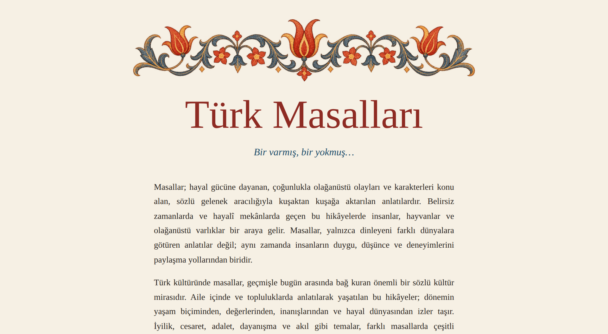
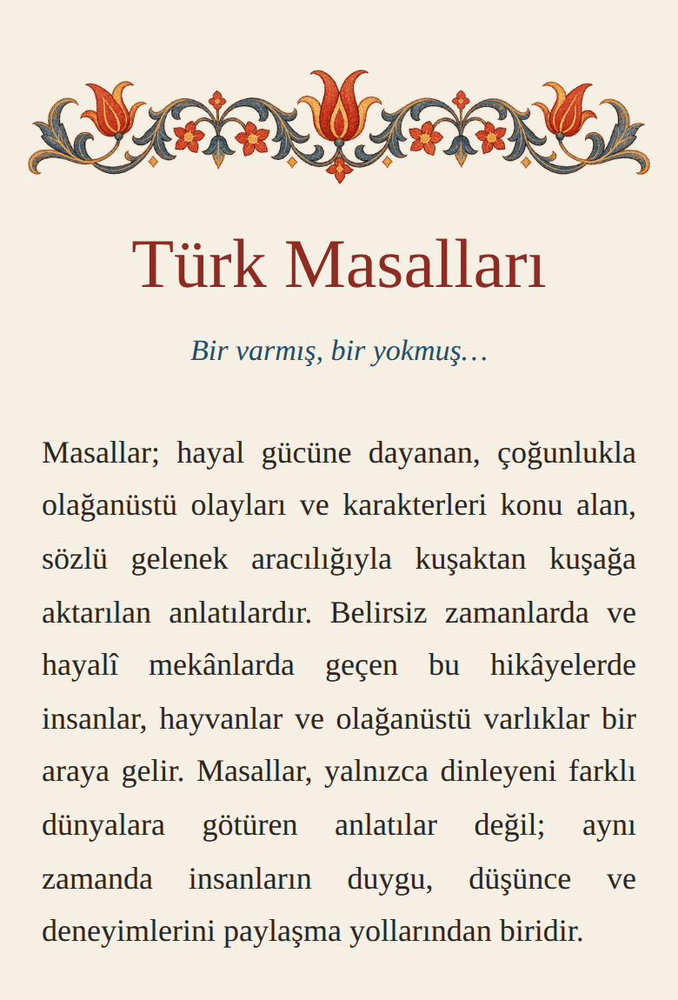

# Türk Masalları Derlemesi

Türk halk anlatı geleneğinden seçilmiş on masalı bir araya getiren, HTML, CSS ve JavaScript ile hazırlanmış bir web sayfası.

| | |
|---|---|
| **Hazırlayan** | Zeynep Sıla Kuştu · GitHub: [@zeynepsilakst-web](https://github.com/zeynepsilakst-web) |
| **Ders** | Programlamaya Giriş · Öğr. Üyesi Meral Şentürk |
| **Bölüm** | İstanbul Medipol Üniversitesi, Görsel İletişim Tasarımı · 2026-2027 Güz |
| **Sürüm** | v2.0 – External CSS ve JS ile yapılandırılmış sürüm |
| **Vize sürümü (v1.0)** | https://github.com/zeynepsilakst-web/turk-masallari |
| **Vize sunum videosu** | https://youtu.be/jac8dAwPfN8 |
| **Codepen** | [Codepen'deki sürüm](https://codepen.io/editor/Zeynep-Kutu/pen/01a1ec4a-0f77-7ded-8d90-e58eba204621) |



---

## İçindekiler

1. [Proje hakkında](#proje-hakkında)
2. [Sayfanın özellikleri](#sayfanın-özellikleri)
3. [Dosya yapısı](#dosya-yapısı)
4. [Dosyalar birbirine nasıl bağlanıyor?](#dosyalar-birbirine-nasıl-bağlanıyor)
5. [Sayfa nasıl açılır?](#sayfa-nasıl-açılır)
6. [Tasarım](#tasarım)
7. [Masallar](#masallar)
8. [Sürüm geçmişi](#sürüm-geçmişi)
9. [Kaynakça](#kaynakça)
10. [Yapay zekâ kullanımı](#yapay-zekâ-kullanımı)
11. [Lisanslar](#lisanslar)

---

## Proje hakkında

Bu proje, Türk masallarını okumaya uygun, sade ve konuya yakışan bir arayüzle sunmak amacıyla hazırlandı. Masallar T.C. Kültür ve Turizm Bakanlığının Kültür Portalı'ndaki derlemelerden seçildi ve olay örgüleri ile sonları korunarak günümüz Türkçesiyle yeniden anlatıldı.

Proje önce vize ödevi olarak, CSS ve JavaScript'in HTML dosyasının içinde olduğu **tek bir dosya** hâlinde hazırlandı (v1.0). Vize sürümü, raporu ve sunum videosuyla birlikte [ayrı bir depoda](https://github.com/zeynepsilakst-web/turk-masallari) olduğu gibi duruyor. Bu sürümde CSS ve JavaScript **harici (external) dosyalara** taşındı (v2.0). Sayfanın görünüşü ve çalışması değişmedi; yalnızca kod daha düzenli bir yapıya kavuştu.

## Sayfanın özellikleri

- **10 Türk masalı:** Bir masala tıklanınca masal, görseliyle birlikte bir pencerede açılır.
- **Masal arama:** Arama kutusu masalları adına göre anında süzer; sonuç yoksa uyarı gösterir. Türkçe büyük-küçük harfler doğru tanınır (ör. "PERİ" yazınca "Peri Kızı" bulunur).
- **Okuma ayarı:** Masal penceresindeki A− / A+ düğmeleriyle yazı boyutu 14 ile 26 piksel arasında değiştirilebilir.
- **Pencereyi kapatma:** × düğmesi, pencerenin dışına tıklama ya da Esc tuşu.
- **Kaynakça penceresi:** Sayfanın altındaki butonla açılır.
- **Duyarlı tasarım:** Sayfa bilgisayarda ve telefonda düzgün görünür.
- **İnternetsiz çalışma:** Harici kütüphane ya da çevrimiçi yazı tipi kullanılmadığı için sayfa internet bağlantısı olmadan açılır.



## Dosya yapısı

```
turk-masallari-v2/
├── index.html     → sayfanın iskeleti (HTML)
├── style.css      → sayfanın görünüşü (CSS)
├── script.js      → sayfanın davranışı (JavaScript)
├── gorseller/     → masal görselleri, kenarlık ve köşe motifi
├── ekran-goruntuleri/ → README'deki ekran görüntüleri
├── README.md      → bu açıklama dosyası
└── LICENSE        → kodun lisansı
```

| Dosya | Görevi | İçinde neler var? |
|---|---|---|
| `index.html` | İskelet | Başlık, tanıtım yazısı, arama kutusu, 10 masal butonu, masal ve kaynakça pencereleri (`<dialog>`) |
| `style.css` | Görünüş | Renk değişkenleri (`:root`), yazı tipi, butonlar, pencereler, büyük ilk harf, telefon uyumu (`@media`) |
| `script.js` | Davranış | Masal verileri (dizi), butona basınca pencereyi açma, arama, yazı boyutu, kaynakça penceresi |

## Dosyalar birbirine nasıl bağlanıyor?

`style.css` ve `script.js`, `index.html` içinde **dosya adlarıyla** bağlanır:

```html
<head>
    ...
    <!-- CSS dosyasını bağlar -->
    <link rel="stylesheet" href="style.css">
</head>
<body>
    ...
    <!-- JavaScript dosyasını bağlar -->
    <script src="script.js"></script>
</body>
```

- **`<link rel="stylesheet" href="style.css">`** `<head>` içindedir. Tarayıcı sayfayı çizmeden önce stilleri yükler.
- **`<script src="script.js"></script>`** `</body>`'den hemen öncedir. JavaScript, butonları ve pencereleri `getElementById` ile bulduğu için önce bütün HTML'in yüklenmesi gerekir; bu yüzden en sona konur.
- `src` (source, kaynak) ve `href` yalnızca dosya adını içerdiği için üç dosyanın **aynı klasörde** durması gerekir.

## Sayfa nasıl açılır?

1. Bu sayfanın üstündeki yeşil **Code** butonuna, sonra **Download ZIP**'e tıklayın.
2. ZIP dosyasını bir klasöre açın.
3. `index.html` dosyasına çift tıklayın; sayfa tarayıcıda açılır.

`style.css`, `script.js` ve `gorseller` klasörü `index.html` ile aynı yerde durmalıdır; aksi hâlde sayfa stilsiz açılır ve görseller görünmez.

## Tasarım

Renkler geleneksel Türk sanatlarından esinlenerek seçildi ve `style.css` dosyasının başında CSS değişkeni olarak tanımlandı:

| Renk | Kod | Esin kaynağı | Kullanıldığı yer |
|---|---|---|---|
| Kök boya kırmızısı | `#8E2B23` | Kilimler | Başlıklar, büyük ilk harf, pencere çizgisi |
| Çini mavisi | `#1D4E6B` | İznik çinileri | Butonların sol şeridi, alt yazılar |
| Altın sarısı | `#C49A3A` | Minyatürler | Görsellerin çift çizgili çerçevesi |
| Kâğıt kremi | `#F6F0E4` | Eski kitap sayfası | Sayfanın arka planı |

Masalın ilk harfi eski el yazması kitaplardaki gibi büyük ve kırmızıdır. Yazı tipi olarak her bilgisayarda bulunan **Georgia** kullanıldı. Masal penceresinin dört köşesindeki motif tek bir görseldir; CSS'te `scaleX(-1)` ve `scaleY(-1)` ile aynalanarak dört köşeye yerleştirildi.

## Masallar

| No | Masal | Tür |
|---|---|---|
| 1 | Peri Kızı | Olağanüstü masal |
| 2 | Çobanla Köpeği | Olağanüstü masal |
| 3 | İnatçı Horoz | Zincirleme masal |
| 4 | Keloğlan ve Altın Bülbül | Olağanüstü masal |
| 5 | Kurnaz Kurt | Hayvan masalı |
| 6 | Reyhan Güzeli ile Padişah Oğlu | Gerçekçi masal |
| 7 | Tuz Kadar Sevgi | Olağanüstü masal |
| 8 | Üç Turunçlar | Olağanüstü masal |
| 9 | Kırk Dost | Gerçekçi masal |
| 10 | İncili Çadır | Olağanüstü masal |

Yeni bir masal eklemek için `script.js` dosyasındaki `masallar` dizisine bir nesne, `index.html` dosyasına da `data-masal` numarası dizideki sırayla aynı olan bir buton eklemek yeterlidir.

## Sürüm geçmişi

| Sürüm | Tarih | Açıklama |
|---|---|---|
| **v2.0** | Kasım 2026 | CSS ve JavaScript harici dosyalara ayrıldı (`style.css`, `script.js`); `index.html` bunlara dosya adlarıyla bağlandı. README genişletildi, lisans dosyası eklendi; proje Codepen'de de oluşturuldu. |
| **v1.0** | Kasım 2026 | Vize teslimi: CSS'in `<style>`, JavaScript'in `<script>` etiketi içinde olduğu tek dosyalı sürüm. [Vize deposu](https://github.com/zeynepsilakst-web/turk-masallari) |

## Kaynakça

Masal metinleri T.C. Kültür ve Turizm Bakanlığının Kültür Portalı'ndan (https://www.kulturportali.gov.tr, erişim: 2 Kasım 2026) yararlanılarak yeniden anlatılmıştır. Parantez içinde masalın ilk yayımlandığı yer verilmiştir.

- Arseven, V. (Derleyen). *İnatçı Horuz (Ocakbaşı Masalı).* (Türk Folklor Araştırmaları Dergisi, 1955, sayı 72.)
- Arseven, V. (Derleyen). *İncili Çadır.* (Türk Folklor Araştırmaları Dergisi, 1967, sayı 221.)
- Çetin, N. (Derleyen). *Reyhan Güzeli ile Padişah Oğlu.* (Türk Folklor Araştırmaları Dergisi, 1968, sayı 225.)
- Çetin, N. (Derleyen). *Üç Turunçlar.* (Türk Folklor Araştırmaları Dergisi, 1968, sayı 227.)
- Kartal, N. (Derleyen). *Çobanla Köpeği.* (Türk Folklor Araştırmaları Dergisi, sayı 205.)
- Kartal, N. (Derleyen). *Kurnaz Kurt Masalı.* (Türk Folklor Araştırmaları Dergisi, 1969, sayı 234.)
- *Peri Kızı.* (Naki Tezel, Türk Masalları I, Kültür Bakanlığı Yayınları, 1990.)
- Sakaoğlu, S. (Derleyen). *Tuz Kadar Sevgi.* (Gümüşhane-Bayburt Masalları, Akçağ Yayınevi, 2002.)
- San, S. (Derleyen). *Kırk Dost Masalı.* (Türk Folklor Araştırmaları Dergisi, 1954, sayı 56.)
- Saygı, O. (Derleyen). *Keloğlan ve Altın Bülbül Masalı.* (Türk Folklor Araştırmaları Dergisi, 1969, sayı 240.)

## Yapay zekâ kullanımı

- **Claude (Anthropic):** Kodun geliştirilmesi, kodun anlaşılması, raporun ve bu README'nin hazırlanmasında yardımcı olarak kullanıldı.
- **ChatGPT (OpenAI):** Sayfadaki masal görselleri, kenarlık ve köşe motifi bu araçla üretildi.

Masalları seçmek, kendi cümlelerimle yeniden anlatmak, görselleri üretip yerlerine karar vermek, kodu satır satır inceleyip açıklama notları yazmak, dosyalara ayırmak, raporun hazırlanmasının temel adımları, son düzenleme ve kontroller bana aittir.
## Lisanslar

Projede farklı türde içerikler olduğu için her biri ayrı değerlendirilmiştir:

| İçerik | Lisans / durum |
|---|---|
| **Kod** (`index.html`, `style.css`, `script.js`) | [MIT Lisansı](LICENSE). Kaynak gösterilerek serbestçe kullanılabilir, değiştirilebilir ve dağıtılabilir. |
| **Masal metinleri** | Masallar halk anlatı geleneğine aittir. Metinler kaynakçadaki derlemelerden yararlanılarak kendi cümlelerimle yeniden anlatılmıştır. Derlemelerin hakları derleyenlerine ve yayıncılarına aittir; metinler eğitim amaçlıdır. |
| **Görseller** (`gorseller/`) | ChatGPT (OpenAI) ile üretilmiştir ve OpenAI'nin kullanım koşullarına tabidir. Telifli karakter ya da başkasına ait çizim içermez. |
| **Yazı tipi** | Bilgisayarlarda yüklü gelen Georgia sistem yazı tipi kullanılmıştır; projeyle birlikte dağıtılmaz. |
